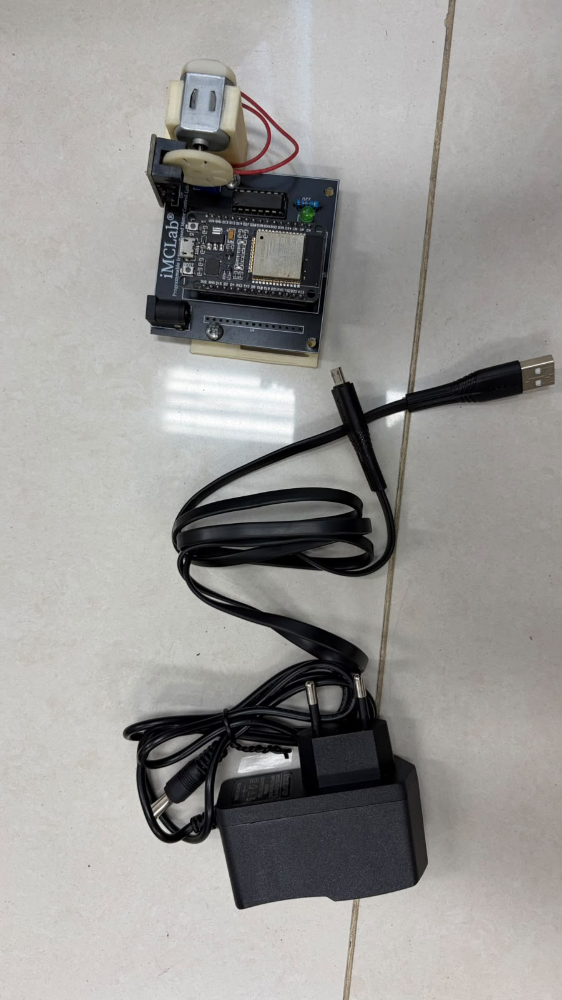
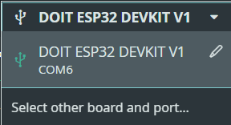
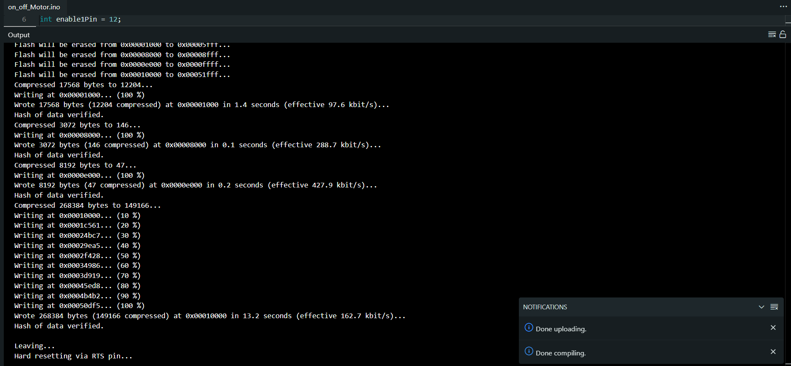
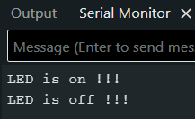
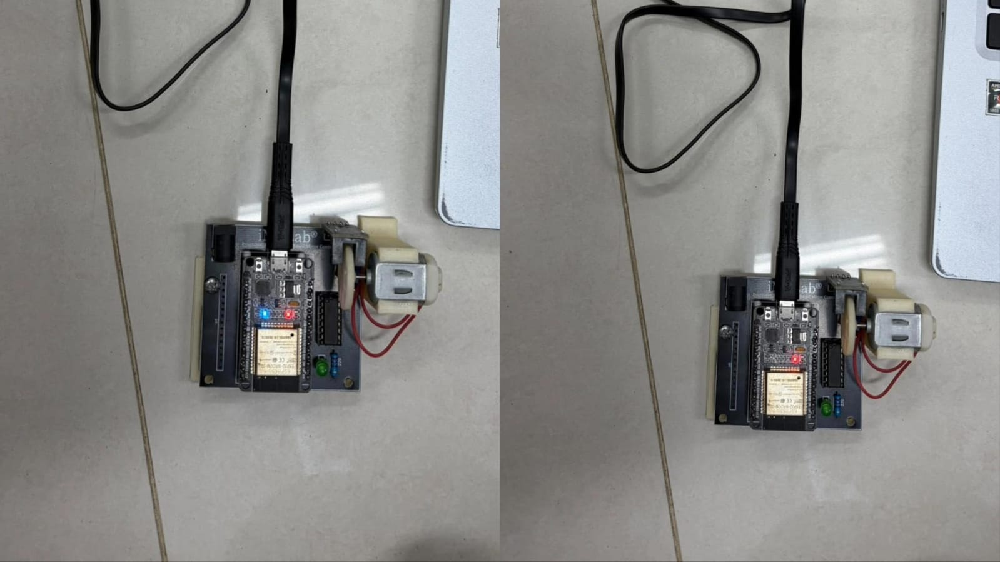
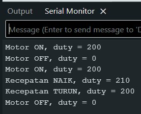
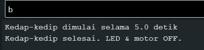
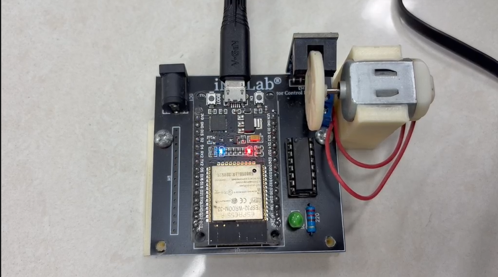

# Laporan Riset Modul 1 - Pemrograman Basic Robotika dengan Kit iMCLab

Mata kuliah Robotika, ETS. Waktu praktik: Oktober 2026. Identitas penulis: lihat [README utama](../../README.md).

## 1. Pendahuluan

Robot bergerak karena aktuator, dan salah satu aktuator paling umum adalah motor DC. Agar motor dapat dikendalikan, mikrokontroler perlu menentukan **kapan** motor menyala dan **seberapa cepat** ia berputar. Modul ini memperkenalkan dasar tersebut pada kit iMCLab yang dikendalikan ESP32: menghidupkan dan mematikan motor, mengatur kecepatan dengan PWM, dan membuat pola kedap-kedip yang tidak mengganggu kemampuan ESP32 menerima perintah.

## 2. Tujuan

1. Mengendalikan LED dan motor DC pada kit iMCLab dengan perintah serial dari Arduino IDE.
2. Memahami pengaturan kecepatan motor dengan PWM (frekuensi, resolusi, duty cycle).
3. Membuat program kedap-kedip dengan `millis()` sehingga ESP32 tetap responsif dan dapat dibatalkan kapan saja.
4. Membandingkan pendekatan `delay()` (blocking) dan `millis()` (non-blocking).

## 3. Alat dan bahan

| No | Alat / bahan | Keterangan |
|---|---|---|
| 1 | Kit iMCLab | motor DC, driver motor, LED indikator |
| 2 | ESP32 | board DOIT ESP32 DEVKIT V1, chip USB-UART CH9102 |
| 3 | Kabel USB data | menghubungkan ESP32 ke laptop |
| 4 | Laptop | Arduino IDE 2.3.10, Serial Monitor pada 115200 baud |


*Gambar 1.1. Kit iMCLab yang digunakan.*

## 4. Landasan teori

### 4.1 PWM (Pulse Width Modulation)

PWM mengatur daya rata-rata ke beban dengan menyalakan dan mematikan sinyal sangat cepat. Perbandingan lama sinyal menyala terhadap satu periode disebut **duty cycle**. Pada kode ini:

- frekuensi PWM = 30.000 Hz (di atas batas pendengaran, sehingga motor tidak berdengung),
- resolusi = 8 bit, sehingga duty bernilai 0 sampai 255,
- duty (%) = nilai / 255 x 100%.

| Nilai duty | Duty (%) |
|---|---|
| 0 | 0 |
| 50 | 19,6 |
| 100 | 39,2 |
| 150 | 58,8 |
| 200 | 78,4 |
| 205 | 80,4 |
| 255 | 100 |

### 4.2 Driver motor dan pemetaan pin

Arah putar ditentukan oleh dua pin kendali (`motor1Pin1`, `motor1Pin2`), sedangkan pin *enable* menerima sinyal PWM yang menentukan kecepatan.

| Fungsi | GPIO |
|---|---|
| LED indikator | 2 |
| Motor pin 1 | 27 |
| Motor pin 2 | 26 |
| Enable (PWM) | 12 |
| Sensor RPM (dipakai di Modul 3) | 13 |

### 4.3 Komunikasi serial

Laptop mengirim karakter ke ESP32 lewat USB pada 115200 baud. ESP32 membaca karakter dan menjalankan aksi yang sesuai. Ada dua gaya penerimaan perintah pada sketch modul ini:

- **satu karakter langsung** (`on_off_Motor`, `kedap_kedip_Motor`): ESP32 bereaksi segera setelah satu karakter diterima,
- **satu baris** (`imclab_naik_turun`): ESP32 mengumpulkan karakter sampai karakter baris baru (`Enter`), sehingga mendukung perintah panjang seperti `PWM:150`.

### 4.4 `delay()` dan `millis()`

`delay(x)` menghentikan program selama x milidetik, dan selama itu ESP32 tidak dapat membaca serial atau melakukan hal lain. `millis()` mengembalikan waktu sejak ESP32 menyala, sehingga program dapat mengecek "sudah cukup lama belum?" tanpa berhenti. Pola ini disebut *non-blocking*.

## 5. Persiapan Arduino IDE

1. Pasang board ESP32 melalui Boards Manager.
2. Pilih board **DOIT ESP32 DEVKIT V1**.
3. Pilih port COM ESP32 pada **Tools - Port** (pada riset ini `COM6`).
4. Upload sketch, lalu buka Serial Monitor pada **115200 baud**.


*Gambar 1.2. Board dan port di Arduino IDE.*

## 6. Eksperimen 1.1 - ON/OFF LED dan motor

**Kode:** [`on_off_Motor/on_off_Motor.ino`](on_off_Motor/on_off_Motor.ino)

### Cara kerja

`loop()` membaca satu karakter dari Serial Monitor.

| Perintah | Aksi | Balasan Serial |
|---|---|---|
| `1` | LED menyala, motor ON dengan duty 205 (sekitar 80%) | `LED is on !!!` |
| `0` | LED mati, motor OFF (duty 0) | `LED is off !!!` |

### Langkah

1. Upload `on_off_Motor.ino`.
2. Buka Serial Monitor (115200), kirim `1`, amati kit, lalu kirim `0`.

### Hasil


*Gambar 1.3. Upload `on_off_Motor` berhasil ("Done uploading").*


*Gambar 1.4. Serial Monitor setelah mengirim `1` dan `0`.*

 
*Gambar 1.5-1.6. Kondisi kit saat ON (kiri) dan OFF (kanan).*

### Analisis

Perintah `1` menyalakan LED dan menggerakkan motor pada duty 205, sedangkan `0` menurunkan duty menjadi 0 sehingga motor berhenti. Balasan `LED is on !!!` dan `LED is off !!!` di Serial Monitor menunjukkan bahwa ESP32 menerima perintah dan menjalankannya. Duty 205 setara sekitar 80% daya, dipilih agar motor mendapat torsi cukup untuk berputar stabil tanpa memakai daya penuh.

## 7. Eksperimen 1.2 - Naik turun kecepatan motor

**Kode:** [`imclab_naik_turun/imclab_naik_turun.ino`](imclab_naik_turun/imclab_naik_turun.ino)

### Cara kerja

Duty awal 200, perubahan per langkah 10, dibatasi 0 sampai 255. Sketch membaca satu baris perintah, sehingga Serial Monitor harus diatur ke **Newline**.

| Perintah | Aksi |
|---|---|
| `1` | motor ON (duty terakhir, atau 200 kalau sebelumnya 0) |
| `0` | motor OFF (duty 0) |
| `+` | duty naik 10 |
| `-` | duty turun 10 |
| `PWM:xxx` | set duty langsung (0-255) |

### Contoh urutan perintah

Urutan berikut diuji dari Python (lihat Modul 2) dan menghasilkan balasan ESP32 sebagai berikut:

```
Motor ON, duty = 200
Kecepatan NAIK, duty = 210
Kecepatan NAIK, duty = 220
Kecepatan NAIK, duty = 230
Kecepatan TURUN, duty = 220
Kecepatan TURUN, duty = 210
Set duty = 150
Motor OFF, duty = 0
```


*Gambar 1.7. Serial Monitor saat perintah `1`, `+`, `-`, dan `PWM:150`.*

### Tabel konversi PWM

Nilai yang dapat dikirim dengan perintah `PWM:xxx` dan duty cycle-nya:

| Perintah | Duty | Duty (%) |
|---|---|---|
| `PWM:50` | 50 | 19,6 |
| `PWM:100` | 100 | 39,2 |
| `PWM:150` | 150 | 58,8 |
| `PWM:200` | 200 | 78,4 |
| `PWM:255` | 255 | 100 |

### Analisis

Setiap perintah `+` menaikkan duty 10 (sekitar 3,9 persen poin) dan setiap `-` menurunkannya dengan besar yang sama. Balasan Serial menunjukkan nilai duty selalu konsisten dengan perintah: 200 naik tiga kali menjadi 230, turun dua kali menjadi 210, lalu `PWM:150` menimpanya langsung. Batas 0 sampai 255 mencegah nilai di luar jangkauan resolusi 8 bit.

## 8. Eksperimen 1.3 - Kedap-kedip beberapa detik

**Kode:** [`kedap_kedip_Motor/kedap_kedip_Motor.ino`](kedap_kedip_Motor/kedap_kedip_Motor.ino) (modifikasi dari `on_off_Motor`)

### Tujuan modifikasi

Kode ON/OFF diubah supaya LED dan motor dapat kedap-kedip selama beberapa detik lalu mati sendiri, tanpa memakai `delay()` sehingga perintah `0` tetap dapat membatalkannya kapan saja.

### Parameter

| Parameter | Nilai di riset ini | Arti |
|---|---|---|
| `BLINK_INTERVAL_MS` | 100 | lama satu fase ON atau OFF (ms) |
| `BLINK_DURATION_MS` | 5000 | total waktu kedap-kedip (ms) |
| `BLINK_MOTOR` | `true` | motor ikut kedip bersama LED (`false` = hanya LED) |

### Perintah

| Perintah | Aksi |
|---|---|
| `1` | LED dan motor ON terus |
| `0` | LED dan motor OFF, membatalkan kedap-kedip |
| `b` | kedap-kedip selama 5 detik lalu otomatis OFF |

### Cara kerja (alur program)

1. Perintah `b` memanggil `mulaiKedip()`: menandai `blinking = true` dan mencatat waktu mulai dengan `millis()`.
2. Setiap putaran `loop()`, `updateKedip()` dijalankan. Fungsi ini membandingkan `millis()` dengan waktu terakhir ganti fase. Kalau sudah lewat `BLINK_INTERVAL_MS`, status LED dibalik (`blinkState = !blinkState`) dan motor mengikuti.
3. Kalau waktu total melewati `BLINK_DURATION_MS`, kedap-kedip dihentikan: LED dan motor dimatikan dan pesan selesai dicetak.
4. `loop()` terus membaca serial di sela-sela itu, sehingga `0` dapat membatalkan kapan saja.

Potongan inti:

```cpp
if (now - lastToggle >= BLINK_INTERVAL_MS) {
  lastToggle = now;
  blinkState = !blinkState;
  digitalWrite(ledPin, blinkState ? HIGH : LOW);
  if (BLINK_MOTOR) { if (blinkState) MotorOn(); else MotorOff(); }
}
```

### Perhitungan

Satu kedipan lengkap = satu fase ON + satu fase OFF = 2 x 100 ms = 200 ms.
Jumlah kedipan dalam 5 detik = 5000 / 200 = **25 kedipan** (frekuensi 5 Hz).
Pada interval awal 500 ms hanya terjadi 5 kedipan (1 Hz).

### Hasil

Balasan ESP32 yang tercatat saat perintah `b` dikirim:

```
Kedap-kedip dimulai selama 5.0 detik
Kedap-kedip selesai. LED & motor OFF.
```


*Gambar 1.8. Serial Monitor saat perintah `b`.*


*Gambar 1.9. LED saat kedap-kedip.*

### Analisis

Dengan `millis()`, program tidak pernah berhenti menunggu: ESP32 mengecek waktu dan membaca serial berulang-ulang, dan hanya mengubah keluaran saat waktunya tiba. Pada versi `delay(100)`, ESP32 diam selama 100 ms setiap fasenya dan perintah serial yang masuk baru terbaca setelah jeda selesai, sehingga pembatalan terasa lambat. Interval 100 ms membuat kedipan cepat; untuk motor, pulsa ON-OFF sependek itu hanya menghasilkan getaran atau putaran sangat singkat karena motor memiliki inersia.

## 9. Kendala dan solusi

| Kendala | Penyebab | Solusi |
|---|---|---|
| Perintah `+`, `-`, `PWM:xxx` tidak bereaksi | `imclab_naik_turun` menunggu karakter baris baru | Set Serial Monitor ke **Newline** |
| Upload berhenti di `Connecting...` | ESP32 tidak masuk mode upload | Tahan tombol **BOOT** sampai upload mulai |

## 10. Kesimpulan

1. Motor dan LED pada kit iMCLab berhasil dikendalikan lewat perintah serial: `1` untuk ON dan `0` untuk OFF.
2. Kecepatan motor diatur lewat PWM 8 bit (0-255) pada 30 kHz. Perintah `+`, `-`, dan `PWM:xxx` mengubah duty secara bertahap atau langsung, dan balasan serial konsisten dengan perintah.
3. Kedap-kedip berbasis `millis()` berhasil: 25 kedipan dalam 5 detik pada interval 100 ms, dan perintah `0` tetap dapat membatalkan karena program tidak terblokir.
4. Pola non-blocking ini menjadi dasar untuk modul berikutnya, di mana ESP32 harus menangani Serial, Blynk, dan OTA secara bersamaan.

## 11. Saran

Pengembangan berikutnya: menambah perintah serial untuk mengubah interval dan durasi kedap-kedip tanpa upload ulang, serta membuat motor berakselerasi bertahap (*ramp*) agar perubahan duty tidak mendadak.

## Lampiran

Kode dan berkas modul ini (relatif terhadap folder modul):

- [`on_off_Motor/on_off_Motor.ino`](on_off_Motor/on_off_Motor.ino)
- [`imclab_naik_turun/imclab_naik_turun.ino`](imclab_naik_turun/imclab_naik_turun.ino)
- [`kedap_kedip_Motor/kedap_kedip_Motor.ino`](kedap_kedip_Motor/kedap_kedip_Motor.ino)

Kembali ke [ringkasan ETS](../README.md).


## Daftar pustaka

1. Rahmat, B. dan Muljono. *Pemrograman Internet of Things (IoT) dengan Arduino dan Python, Jilid 1*. CV Eureka Media Aksara.
2. Rahmat, B. *Integrasi AI dan IoT pada Sistem Kendali Cerdas* (materi kuliah), dan repositori kode kit iMCLab `github.com/bsrahmat/imclab`.
3. Dokumentasi Espressif untuk ESP32: LEDC (PWM) dan antarmuka serial.