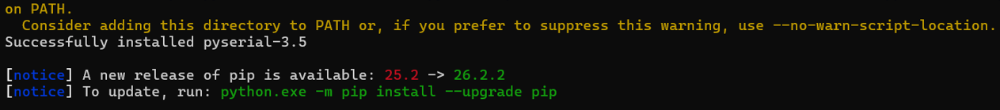
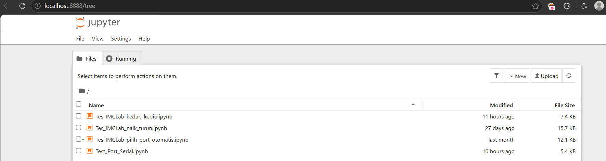
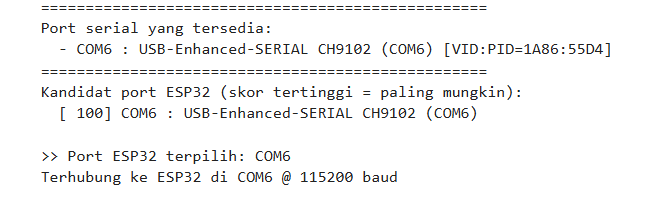
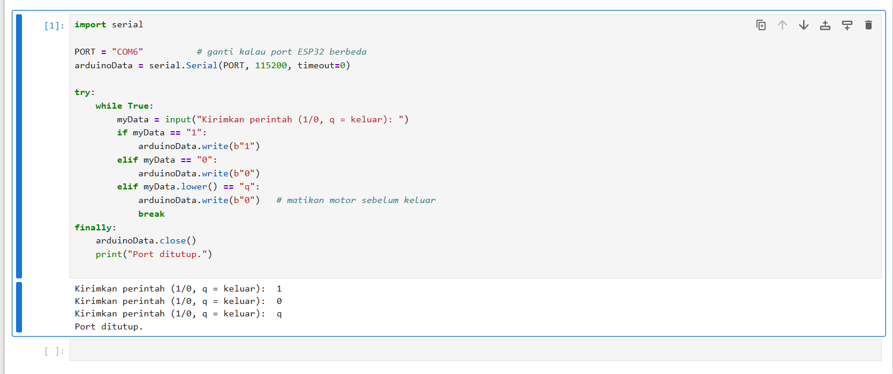
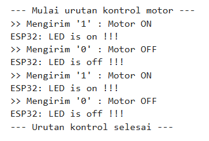
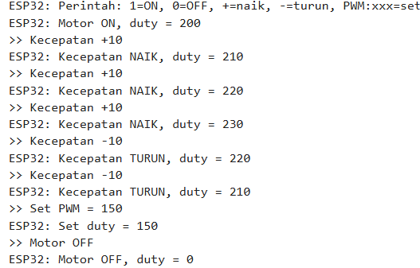
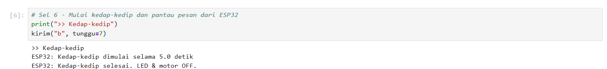

# Laporan Riset Modul 2 - Pemrograman Robotika dengan Kit iMCLab Menggunakan Python

Mata kuliah Robotika, ETS. Waktu praktik: Oktober 2026. Identitas penulis: lihat [README utama](../../README.md).

## 1. Pendahuluan

Pada Modul 1, perintah dikirim dari Serial Monitor Arduino. Cara itu cukup untuk uji sederhana, tetapi tidak dapat diprogram: tidak ada urutan otomatis, perhitungan, atau pencatatan data. Python menyelesaikan keterbatasan ini. Dengan pustaka `pyserial`, program Python membuka port serial yang sama dan mengirim perintah ke ESP32, sehingga kit dapat dikendalikan dari skrip yang dapat diulang dan dikembangkan, misalnya untuk akuisisi data atau kendali berbasis AI di tahap EAS.

## 2. Tujuan

1. Mengendalikan kit iMCLab dari laptop memakai Python lewat komunikasi serial USB.
2. Mendeteksi port ESP32 secara otomatis.
3. Menjalankan dan mendokumentasikan eksperimen di Jupyter Notebook.
4. Membandingkan kendali lewat Serial Monitor dengan kendali lewat Python.

## 3. Alat dan bahan

| Komponen | Keterangan |
|---|---|
| Kit iMCLab + ESP32 | board DOIT ESP32 DEVKIT V1, chip USB-UART CH9102 |
| Kabel USB data | laptop ke ESP32 |
| Python 3 | pustaka `pyserial` 3.5 dan Jupyter Notebook |
| Arduino IDE 2.3.10 | untuk upload sketch pasangan notebook |
| (opsional) VS Code | dengan ekstensi Python dan Jupyter |

## 4. Landasan teori

### 4.1 Port serial dan `pyserial`

Saat ESP32 dicolok lewat USB, Windows membuat port serial virtual (misalnya `COM6`) melalui chip USB-UART di board. `pyserial` membuka port itu dengan `serial.Serial(port, baudrate)`. Perintah dikirim dengan `write()` dan balasan dibaca dengan `readline()`. Baud rate (115200) harus sama dengan `Serial.begin()` di sketch.

### 4.2 Reset otomatis saat port dibuka

Pada banyak board ESP32, membuka port serial memicu sinyal DTR/RTS yang me-reset ESP32. Akibatnya log booting (`ets Jun 8 2016 ...`, `rst:0x1 (POWERON_RESET)`, dan seterusnya) ikut terbaca oleh Python, dan perintah yang dikirim di saat booting dapat tertunda. Karena itu kode memberi jeda 2 detik setelah membuka koneksi.

### 4.3 Deteksi port otomatis

Nomor COM bisa berubah ketika kabel dipindah ke lubang USB lain. Notebook otomatis memberi skor pada setiap port berdasarkan:

- **VID:PID** chip USB-UART yang dikenal (CP210x, CH340, FTDI, dan lainnya, termasuk CH9102 dengan VID:PID `1A86:55D4`), bernilai +100,
- kata kunci pada deskripsi port (misalnya `cp210`, `ch340`, `ftdi`, `usb-serial`, `esp32`), bernilai +50,
- pengurangan skor untuk port Bluetooth.

Port dengan skor tertinggi dipilih sebagai port ESP32.

### 4.4 Jupyter Notebook

Jupyter menjalankan kode Python per sel dan menyimpan hasilnya di dalam berkas `.ipynb`. Server Jupyter berjalan di laptop sendiri (`localhost:8888`), sehingga Python dapat mengakses port USB. Layanan online seperti Google Colab tidak dapat dipakai karena kodenya berjalan di server lain yang tidak melihat ESP32.

## 5. Pasangan notebook dan sketch

Setiap notebook harus dipasangkan dengan sketch yang benar karena format perintahnya berbeda.

| Notebook | Fungsi | Sketch yang diupload |
|---|---|---|
| [`Test_Port_Serial.ipynb`](Test_Port_Serial.ipynb) | port ditulis manual (`COM6`), kirim `1`/`0`, keluar dengan `q` | `on_off_Motor` |
| [`Tes_IMCLab_pilih_port_otomatis.ipynb`](Tes_IMCLab_pilih_port_otomatis.ipynb) | deteksi port otomatis, urutan ON/OFF, mode interaktif | `on_off_Motor` |
| [`Tes_IMCLab_naik_turun.ipynb`](Tes_IMCLab_naik_turun.ipynb) | deteksi port otomatis, ON/OFF, `+`, `-`, `PWM:xxx` | `imclab_naik_turun` |
| [`Tes_IMCLab_kedap_kedip.ipynb`](Tes_IMCLab_kedap_kedip.ipynb) | deteksi port, ON/OFF, kedap-kedip (`b`), dibagi per sel | `kedap_kedip_Motor` |

`imclab_naik_turun` menunggu karakter baris baru (`\n`), sedangkan `on_off_Motor` dan `kedap_kedip_Motor` membaca satu karakter langsung. Notebook yang berpasangan dengan `imclab_naik_turun` mengirim perintah berakhiran `\n`.

## 6. Instalasi dan persiapan

```
pip install pyserial jupyter
python -m serial.tools.list_ports
cd /d "<folder modul 2>"
python -m notebook
```

Catatan: nama paketnya `pyserial`, bukan `serial`. Kalau perintah `jupyter` tidak dikenali karena folder `Scripts` belum masuk PATH, gunakan `python -m notebook`.


*Gambar 2.1. `pyserial-3.5` berhasil dipasang.*


*Gambar 2.2. Halaman Jupyter di `localhost:8888`.*

### Urutan kerja setiap notebook

1. Colok ESP32.
2. Upload sketch pasangan notebook dari Arduino IDE (port `COM6`).
3. **Tutup Serial Monitor Arduino** (satu port hanya dapat dipakai satu program).
4. Jalankan notebook dengan Shift+Enter.
5. Selesai: akhiri dengan `q` atau sel tutup koneksi agar port dilepas.

## 7. Eksperimen

### 7.1 Deteksi port otomatis

Hasil yang tercatat di notebook:

```
Port serial yang tersedia:
  - COM6 : USB-Enhanced-SERIAL CH9102 (COM6) [VID:PID=1A86:55D4]
Kandidat port ESP32 (skor tertinggi = paling mungkin):
  [ 100] COM6 : USB-Enhanced-SERIAL CH9102 (COM6)

>> Port ESP32 terpilih: COM6
Terhubung ke ESP32 di COM6 @ 115200 baud
```


*Gambar 2.3. Daftar port dan port ESP32 terpilih.*

Skor 100 (bukan 150) menunjukkan port dikenali **hanya lewat VID:PID** chip CH9102. Deskripsi port `USB-Enhanced-SERIAL CH9102` tidak mengandung satu pun kata kunci pada daftar, sehingga tambahan +50 dari kata kunci tidak terjadi. Ini memperlihatkan bahwa VID:PID adalah penanda yang lebih andal daripada teks deskripsi, yang berbeda-beda antar driver. Hanya ada satu kandidat sehingga pemilihan tidak ambigu.

### 7.2 `Test_Port_Serial` (port manual)

Versi asli menulis port `COM11` langsung di kode, yang tidak sesuai dengan port ESP32 pada komputer ini. Kode diubah:

- port diganti menjadi `COM6`,
- ditambah perintah `q` untuk keluar dan `try/finally` supaya port selalu ditutup.

Hasil:

```
Kirimkan perintah (1/0, q = keluar):  1
Kirimkan perintah (1/0, q = keluar):  0
```


*Gambar 2.4. Perintah `1` dan `0` pada `Test_Port_Serial`, dan foto kit saat merespons.*

### 7.3 `Tes_IMCLab_pilih_port_otomatis`

Setelah port terpilih, notebook menjalankan urutan otomatis: ON, OFF, ON, OFF, lalu masuk mode interaktif (`1`, `0`, `q`).

```
--- Mulai urutan kontrol motor ---
>> Mengirim '1' : Motor ON
>> Mengirim '0' : Motor OFF
>> Mengirim '1' : Motor ON
>> Mengirim '0' : Motor OFF
--- Urutan kontrol selesai ---

Mode interaktif: ketik '1'=ON, '0'=OFF, 'q'=keluar
```

Di sela urutan terlihat baris log booting ESP32 (`ets Jun 8 2016 ...`, `rst:0x1 (POWERON_RESET) ...`). Itu bukti bahwa ESP32 melakukan reset saat port dibuka, sesuai landasan teori 4.2.


*Gambar 2.5. Output urutan otomatis dan foto kit.*

### 7.4 `Tes_IMCLab_naik_turun`

Urutan yang dijalankan dan balasan ESP32:

```
>> Motor ON            ESP32: Motor ON, duty = 200
>> Kecepatan +10       ESP32: Kecepatan NAIK, duty = 210
>> Kecepatan +10       ESP32: Kecepatan NAIK, duty = 220
>> Kecepatan +10       ESP32: Kecepatan NAIK, duty = 230
>> Kecepatan -10       ESP32: Kecepatan TURUN, duty = 220
>> Kecepatan -10       ESP32: Kecepatan TURUN, duty = 210
>> Set PWM = 150       ESP32: Set duty = 150
>> Motor OFF           ESP32: Motor OFF, duty = 0
```

Mode interaktif yang tersedia sesudahnya: `1` ON, `0` OFF, `+` naik 10, `-` turun 10, `p150` set PWM langsung, `q` keluar. Notebook mengubah `p150` menjadi `PWM:150` sebelum dikirim.


*Gambar 2.6. Perintah naik-turun dan set PWM dari Python.*

### 7.5 `Tes_IMCLab_kedap_kedip`

Notebook dibagi per sel supaya setiap tahap dapat dilihat hasilnya. Output yang tercatat:

```
Port serial yang tersedia:
  - COM6 : USB-Enhanced-SERIAL CH9102 (COM6)

Port ESP32 terpilih: COM6
Terhubung ke ESP32 di COM6 @ 115200 baud

>> ON
ESP32: LED is on !!!
>> OFF
ESP32: LED is off !!!

>> Kedap-kedip
ESP32: Kedap-kedip dimulai selama 5.0 detik
ESP32: Kedap-kedip selesai. LED & motor OFF.
```

Sel kedap-kedip menunggu 7 detik supaya pesan awal dan akhir sama-sama terbaca, karena kedap-kedip sendiri berlangsung 5 detik.


*Gambar 2.7. Perintah `b` dari Python beserta balasan ESP32.*

## 8. Analisis

**Serial Monitor vs Python.** Keduanya memakai jalur yang sama (USB serial) dan sketch yang sama. Perbedaannya, Python dapat mengotomasi urutan (ON, tunggu, OFF), memeriksa balasan, memilih port sendiri, dan nantinya menyimpan atau memproses data. Serial Monitor hanya cocok untuk uji manual.

**Deteksi port.** Penulisan port manual (`COM11`) rapuh: ketika nomor port berbeda, program gagal. Deteksi otomatis berbasis VID:PID bekerja selama chip USB-UART dikenal, tetapi tetap perlu diverifikasi lewat daftar port yang dicetak.

**Format perintah.** Perintah harus sesuai dengan cara sketch membacanya. `imclab_naik_turun` membaca per baris, sehingga setiap perintah dikirim dengan karakter baris baru. Sketch yang membaca satu karakter tidak membutuhkannya. Salah pasangan notebook dan sketch tidak menimbulkan pesan error, hanya motor yang tidak bereaksi.

**Reset saat port dibuka.** Log booting yang muncul di output menunjukkan ESP32 restart tiap kali Python membuka port. Jeda 2 detik mengurangi risiko perintah pertama terlewat, tetapi pesan balasan di notebook port otomatis tidak seluruhnya tertangkap.

## 9. Kendala dan solusi

| Kendala | Penyebab | Solusi |
|---|---|---|
| `Test_Port_Serial` tidak merespons pada awalnya | Kode memakai `COM11`, sedangkan port ESP32 adalah `COM6` | Ganti nomor port di kode, atau gunakan notebook deteksi otomatis |
| Sel kode `Test_Port_Serial` tidak dapat diedit di editor notebook | Editor tidak mengizinkan perubahan pada sel (kemungkinan izin berkas atau mode terbatas) | Dibuat notebook baru dengan port `COM6` |
| `PermissionError` / *Access is denied* | Serial Monitor Arduino atau sesi Python sebelumnya masih memakai port | Tutup Serial Monitor, lalu **Kernel - Restart** |
| `KeyboardInterrupt: Interrupted by user` | Program berputar tanpa batas dan dihentikan dengan tombol Interrupt | Perilaku normal; tambahkan perintah keluar (`q`) dan penutupan port |
| Peringatan "Scripts ... which is not on PATH" saat memasang pyserial | Folder `Scripts` belum ada di PATH | Abaikan untuk pyserial; jalankan Jupyter dengan `python -m notebook` |
| `ModuleNotFoundError: No module named 'serial'` pada kernel VS Code | Kernel yang dipilih belum memiliki pyserial | Pilih kernel Python yang memiliki pyserial atau `%pip install pyserial` |

## 10. Kesimpulan

1. Kit iMCLab berhasil dikendalikan dari Python lewat `pyserial` pada 115200 baud, dengan seluruh perintah Modul 1 (ON/OFF, naik-turun, PWM langsung, kedap-kedip) dapat dikirim dari notebook.
2. Port ESP32 terdeteksi otomatis sebagai `COM6` (CH9102, VID:PID 1A86:55D4) dengan metode skor, lebih andal daripada menulis nomor port secara manual.
3. Setiap notebook harus dipasangkan dengan sketch yang tepat, dan Serial Monitor Arduino harus ditutup agar port dapat dipakai Python.
4. ESP32 melakukan reset saat port dibuka, sehingga program perlu memberi jeda sebelum mengirim perintah pertama.

## 11. Saran

Tahap berikutnya dapat menambahkan pencatatan data RPM dan PWM dari ESP32 ke Python (misalnya dalam format CSV) beserta grafiknya, sebagai dasar eksperimen kendali berbasis AI pada EAS.

## Lampiran

Kode dan berkas modul ini (relatif terhadap folder modul):

- [`Test_Port_Serial.ipynb`](Test_Port_Serial.ipynb)
- [`Tes_IMCLab_pilih_port_otomatis.ipynb`](Tes_IMCLab_pilih_port_otomatis.ipynb)
- [`Tes_IMCLab_naik_turun.ipynb`](Tes_IMCLab_naik_turun.ipynb)
- [`Tes_IMCLab_kedap_kedip.ipynb`](Tes_IMCLab_kedap_kedip.ipynb)

Kembali ke [ringkasan ETS](../README.md)


## Daftar pustaka

1. Rahmat, B. dan Muljono. *Pemrograman Internet of Things (IoT) dengan Arduino dan Python, Jilid 1*. CV Eureka Media Aksara.
2. Rahmat, B. *Integrasi AI dan IoT pada Sistem Kendali Cerdas* (materi kuliah), dan repositori kode kit iMCLab `github.com/bsrahmat/imclab`.
3. Dokumentasi `pyserial` (penggunaan `serial.Serial` dan `serial.tools.list_ports`).
4. Dokumentasi Project Jupyter (Jupyter Notebook).