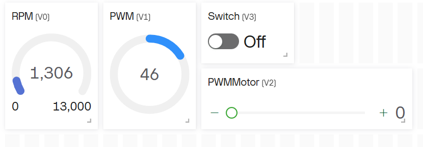
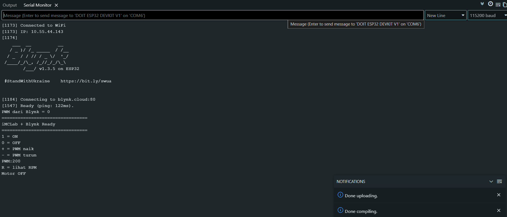
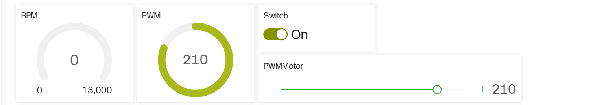
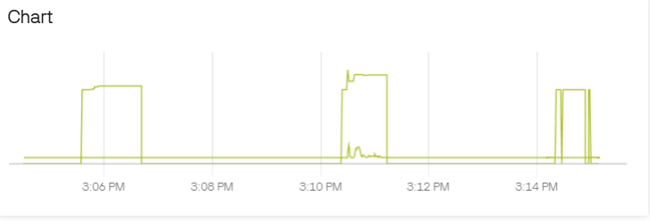
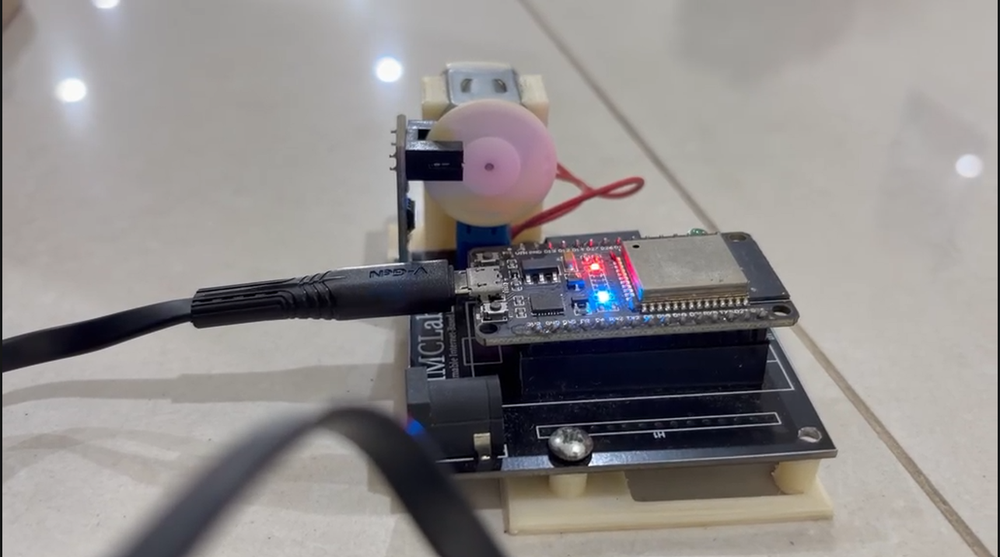
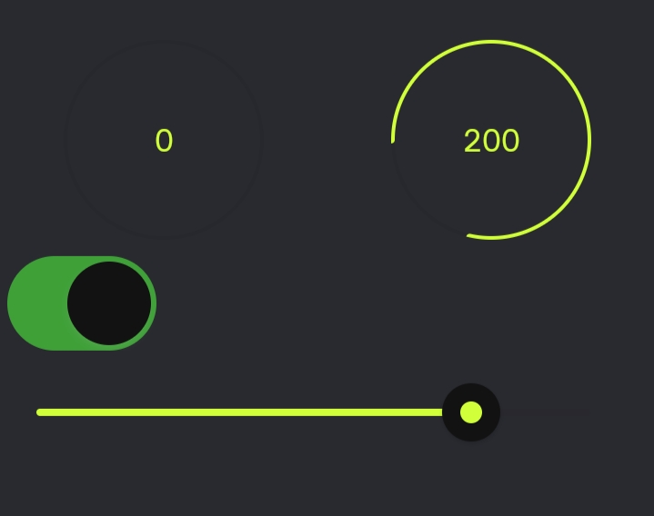

# Laporan Riset Modul 3 - Pemrograman iMCLab Berbasis Blynk

Mata kuliah Robotika, ETS. Waktu praktik: Oktober 2026. Identitas penulis: lihat [README utama](../../README.md).

## 1. Pendahuluan

Pada Modul 1 dan 2, kit dikendalikan lewat kabel USB sehingga laptop harus berada di dekat kit. Internet of Things (IoT) menghilangkan batasan ini: kit tersambung ke jaringan, dan pengendalian dilakukan dari jauh lewat cloud. Blynk IoT adalah platform yang menyediakan cloud, dashboard web, dan aplikasi HP tanpa perlu membangun server sendiri. Pada modul ini kit iMCLab dihubungkan ke Blynk untuk mengendalikan motor (PWM dan ON/OFF) dan memantau RPM secara real time.

## 2. Tujuan

1. Menghubungkan ESP32 pada kit iMCLab ke Blynk IoT lewat WiFi.
2. Mengendalikan motor dari dashboard web dan aplikasi mobile.
3. Memantau RPM dan duty cycle secara real time.
4. Menganalisis hubungan PWM dengan RPM.

## 3. Alat dan bahan

| Komponen | Keterangan |
|---|---|
| Kit iMCLab + ESP32 | dengan sensor RPM (encoder) pada GPIO 13 |
| Jaringan WiFi 2,4 GHz | hotspot HP atau router (ESP32 tidak mendukung 5 GHz) |
| Laptop | Arduino IDE 2.3.10, browser untuk Blynk Console |
| HP | aplikasi Blynk IoT |
| Akun Blynk IoT | server region SGP1 |

## 4. Landasan teori

### 4.1 Arsitektur Blynk

Blynk terdiri dari tiga bagian yang saling terhubung:

- **Template**: cetak biru perangkat, berisi daftar datastream dan tampilan dashboard,
- **Device**: perangkat nyata yang dibuat dari template, dengan Auth Token unik,
- **Dashboard**: widget (gauge, slider, switch, chart) yang terhubung ke datastream.

ESP32 terhubung ke Blynk Cloud lewat WiFi. Dashboard web dan aplikasi tidak berbicara langsung dengan ESP32, tetapi lewat cloud.

### 4.2 Datastream (virtual pin)

| Virtual pin | Arah | Fungsi | Tipe |
|---|---|---|---|
| V0 | ESP32 ke Blynk | RPM | Double |
| V1 | ESP32 ke Blynk | Duty cycle (tampilan) | Integer 0-255 |
| V2 | dua arah | Slider PWM | Integer 0-255 |
| V3 | dua arah | Tombol ON/OFF | Integer 0-1 |

Dashboard pada riset ini berisi empat widget: gauge **RPM** (V0, rentang 0-13.000), gauge **PWM** (V1), **Switch** (V3), dan slider **PWMMotor** (V2).

### 4.3 Perhitungan RPM

Sensor RPM adalah encoder bercelah. Setiap celah yang lewat menghasilkan pulsa, dan ESP32 menghitungnya dengan interupsi (`FALLING`) pada GPIO 13. Interupsi dipilih supaya tidak ada pulsa terlewat meskipun `loop()` sedang sibuk. Untuk menolak pulsa palsu akibat derau, pulsa yang datang kurang dari 500 mikrodetik setelah pulsa sebelumnya diabaikan (*debounce*).

Setiap 1 detik, RPM dihitung:

```
rot_per_sec = jumlah_pulsa / HOLES
RPM         = rot_per_sec x 60
```

dengan `HOLES = 2` (jumlah celah pada piringan encoder). Contoh: 100 pulsa dalam 1 detik berarti 50 putaran per detik, atau 3000 RPM. Karena dihitung per detik, resolusi RPM adalah 30 RPM (satu pulsa = 0,5 putaran/detik).

## 5. Implementasi kode

**Kode:** [`imclab_Blynk_kelas/imclab_Blynk_kelas.ino`](imclab_Blynk_kelas/imclab_Blynk_kelas.ino)

### 5.1 Konfigurasi di bagian atas

```cpp
#include "secrets.h"          // paling atas: BLYNK_TEMPLATE_ID, BLYNK_TEMPLATE_NAME,
                              // BLYNK_AUTH_TOKEN, WIFI_SSID, WIFI_PASS
#define BLYNK_PRINT Serial    // tampilkan log koneksi di Serial Monitor

#include <WiFi.h>
#include <BlynkSimpleEsp32.h>

char auth[] = BLYNK_AUTH_TOKEN;
char ssid[] = WIFI_SSID;
char pass[] = WIFI_PASS;
```

Data rahasia dipisah ke `secrets.h` (diabaikan Git; contoh isinya di [`secrets.example.h`](imclab_Blynk_kelas/secrets.example.h)). Makro Blynk di dalamnya harus terbaca sebelum `#include <BlynkSimpleEsp32.h>`, karena itu `#include "secrets.h"` diletakkan paling atas. `BLYNK_PRINT Serial` menambah log koneksi di Serial Monitor sehingga alasan gagal terhubung terlihat.

### 5.2 Pusat kendali motor: `applyMotor()`

Semua jalur kendali (slider, tombol, Serial) memanggil `applyMotor()`. Fungsi ini menerapkan duty ke PWM, menyalakan LED bila duty lebih dari 0, lalu mengirim nilai V1, V2, dan V3 ke Blynk. Dengan satu pintu ini, slider, tombol, dan Serial Monitor selalu sinkron.

### 5.3 Menerima perintah dari dashboard

```cpp
BLYNK_WRITE(V2) {            // slider PWM
  dutyCycle = constrain(param.asInt(), DUTY_MIN, DUTY_MAX);
  motorEnable = (dutyCycle > 0);
  applyMotor();
}

BLYNK_WRITE(V3) {            // tombol ON/OFF
  motorEnable = param.asInt();
  if (motorEnable) { if (dutyCycle == 0) dutyCycle = 200; }
  else             { dutyCycle = 0; }
  applyMotor();
}
```

### 5.4 Mengirim data ke dashboard

`BlynkTimer` memanggil `kirimKeBlynk()` setiap 1 detik, yang mengirim RPM (V0), duty (V1), slider (V2), dan tombol (V3). Tidak ada `delay()` di dalam `loop()`; `Blynk.run()` dan `timer.run()` dipanggil terus menerus.

### 5.5 Sinkronisasi saat tersambung

```cpp
BLYNK_CONNECTED() {
  Blynk.syncVirtual(V2);
  Blynk.syncVirtual(V3);
}
```

Setiap kali ESP32 tersambung atau tersambung ulang, nilai terakhir slider dan tombol diminta dari cloud. Konsekuensinya, jika terakhir kali tombol ON, motor dapat langsung berputar setelah ESP32 menyala.

### 5.6 Perintah Serial Monitor

Selain Blynk, Serial Monitor tetap berfungsi dan hasilnya ikut tampil di dashboard: `1`, `0`, `+`, `-`, `PWM:xxx`, dan `R` (cetak RPM dan PWM).

## 6. Konfigurasi Blynk

1. Buat **Template** dengan nama dan Template ID yang sama dengan isi `secrets.h`, lalu tambahkan datastream V0 sampai V3.
2. Buat **Device** dari template, lalu salin Auth Token ke `secrets.h`.
3. Buat **Dashboard** web: gauge RPM (V0), gauge PWM (V1), slider PWMMotor (V2, rentang 0-255), dan Switch (V3).
4. Salin `secrets.example.h` menjadi `secrets.h` di folder sketch, isi nilainya (Template ID, Template Name, Auth Token, nama dan password WiFi), lalu upload ke ESP32.
5. Buka Serial Monitor (115200) dan pastikan koneksi berhasil.


*Gambar 3.1. Datastream V0-V3 pada template. Auth Token disamarkan.*

## 7. Eksperimen 3.1 - Blynk IoT web

### Langkah

1. Upload kode, buka Serial Monitor, tekan **EN** pada board.
2. Pastikan banner `iMCLab + Blynk Ready` tampil dan status device **Online**.
3. Di dashboard web, nyalakan Switch dan geser slider.
4. Amati motor dan gauge RPM serta PWM.

### Hasil


*Gambar 3.2. Serial Monitor saat tersambung ke Blynk.*


*Gambar 3.3. Device berstatus Online.*


*Gambar 3.4. Dashboard web saat motor berputar (RPM dan PWM tidak nol).*


*Gambar 3.5. Grafik RPM terhadap waktu (widget Chart pada V0).*


*Gambar 3.6. Kit saat dikendalikan dari Blynk.*

## 8. Eksperimen 3.2 - Blynk IoT aplikasi mobile

Dashboard yang sama ditampilkan di aplikasi Blynk pada HP dengan widget slider, switch, dan gauge. Perubahan di HP tampil di web, dan sebaliknya, karena keduanya membaca datastream yang sama.


*Gambar 3.7. Dashboard di aplikasi Blynk pada HP.*

## 9. Pengamatan PWM terhadap RPM

Slider PWMMotor digeser bertahap dan gauge RPM (V0), gauge PWM (V1), serta grafik riwayat diamati pada dashboard. Gambar 3.4 dan Gambar 3.5 menampilkan RPM dan PWM saat motor berputar.

| Nilai PWM | Duty (%) |
|---|---|
| 50 | 19,6 |
| 100 | 39,2 |
| 150 | 58,8 |
| 200 | 78,4 |
| 255 | 100 |

<!--
OPSIONAL - tabel pengukuran sendiri. Hapus tanda komentar ini kalau mau dipakai, isi kolom RPM dari pengukuran (jangan diperkirakan):

| PWM | Duty (%) | RPM terbaca |
|---|---|---|
| 100 | 39,2 | ... |
| 150 | 58,8 | ... |
| 200 | 78,4 | ... |
| 255 | 100 | ... |
-->

## 10. Analisis

**Hubungan PWM dan RPM.** Secara teori, RPM motor DC naik seiring tegangan rata-rata (yaitu duty PWM). Namun pada duty rendah motor tidak langsung berputar karena torsi awal belum cukup mengatasi gesekan statis, sehingga RPM tetap 0 sampai duty melewati ambang tertentu.

**Resolusi RPM.** Karena RPM dihitung dari jumlah pulsa per detik dan `HOLES = 2`, nilai RPM naik dalam kelipatan 30 RPM. Perubahan kecil di bawah itu tidak akan terbaca. Selain itu, angka baru berubah sekitar 1 sampai 2 detik setelah motor berputar.

**Latensi.** Perintah dari dashboard melewati internet, Blynk Cloud, lalu kembali ke ESP32, dan data RPM dikirim ke cloud setiap 1 detik. Jadi tampilan RPM selalu tertinggal sampai sekitar satu detik dari kondisi nyata.

**Kendali cloud dibanding USB.** Kendali lewat cloud tidak membutuhkan kabel dan dapat dilakukan dari mana saja, termasuk HP. Kekurangannya adalah ketergantungan pada WiFi dan internet, serta latensi yang lebih besar dibanding USB.

**Sinkronisasi.** Karena semua jalur memakai `applyMotor()`, perintah dari Serial Monitor tetap tercermin di slider dan switch dashboard. `syncVirtual` memastikan keadaan dashboard dan ESP32 sama setelah tersambung ulang, tetapi motor dapat berputar sendiri jika keadaan terakhir di cloud adalah ON.

## 11. Kendala dan solusi

| Kendala | Penyebab | Solusi |
|---|---|---|
| Device berstatus **Offline**, Serial Monitor berhenti di `Connecting to <nama WiFi>` | ESP32 tidak tersambung ke WiFi: nama atau password tidak persis sama, hotspot mati, atau jaringan 5 GHz | Nama WiFi pada kode dikoreksi agar persis sama dengan nama hotspot (termasuk spasi dan huruf besar-kecil), hotspot dipastikan menyala di 2,4 GHz, dan log Blynk diaktifkan dengan `BLYNK_PRINT` |
| Alasan kegagalan koneksi tidak terlihat | Log Blynk belum aktif | Tambahkan `#define BLYNK_PRINT Serial` sebelum `#include <BlynkSimpleEsp32.h>` |
| Pesan log booting tidak tertangkap di Serial Monitor | Serial Monitor dibuka setelah ESP32 selesai booting | Tekan **EN** setelah Serial Monitor terbuka |

## 12. Catatan keamanan

Auth Token Blynk dan password WiFi disimpan di `secrets.h`, yang diabaikan Git (lihat `.gitignore`). Yang di-push hanya `secrets.example.h` berisi nilai pengganti. Jika token pernah terlihat di screenshot atau ter-commit, buat ulang token di halaman device Blynk.

## 13. Kesimpulan

1. Kit iMCLab berhasil terhubung ke Blynk IoT lewat WiFi dan dikendalikan dari dashboard web dan aplikasi HP, dengan slider PWM (V2) dan tombol ON/OFF (V3).
2. RPM dihitung dari pulsa encoder dengan interupsi dan debounce, lalu dikirim ke dashboard (V0) setiap detik bersama duty cycle (V1).
3. Pola kode non-blocking (`BlynkTimer`, tanpa `delay()`) menjaga koneksi Blynk tetap hidup sambil melayani Serial Monitor dan sensor.
4. Hubungan PWM dan RPM dapat diamati langsung pada dashboard dan grafik: slider PWM menentukan duty, dan RPM terbaca pada gauge dan grafik riwayat (Bagian 9).

## 14. Saran

Penggunaan chart dengan dua garis (RPM dan PWM dalam satu grafik), pembatasan laju pengiriman slider untuk menghindari pelampauan batas pesan Blynk, dan penambahan notifikasi atau otomasi (misalnya peringatan bila RPM melebihi batas) dapat dikembangkan.

## Lampiran

Kode dan berkas modul ini (relatif terhadap folder modul):

- [`imclab_Blynk_kelas/imclab_Blynk_kelas.ino`](imclab_Blynk_kelas/imclab_Blynk_kelas.ino)
- [`imclab_Blynk_kelas/secrets.example.h`](imclab_Blynk_kelas/secrets.example.h)

Kembali ke [ringkasan ETS](../README.md).


## Daftar pustaka

1. Rahmat, B. dan Muljono. *Pemrograman Internet of Things (IoT) dengan Arduino dan Python, Jilid 1*. CV Eureka Media Aksara.
2. Rahmat, B. *Integrasi AI dan IoT pada Sistem Kendali Cerdas* (materi kuliah), dan repositori kode kit iMCLab `github.com/bsrahmat/imclab`.
3. Dokumentasi Blynk IoT: template, datastream, virtual pin, dan dashboard.
4. Dokumentasi Espressif untuk ESP32: LEDC (PWM) dan interupsi GPIO.