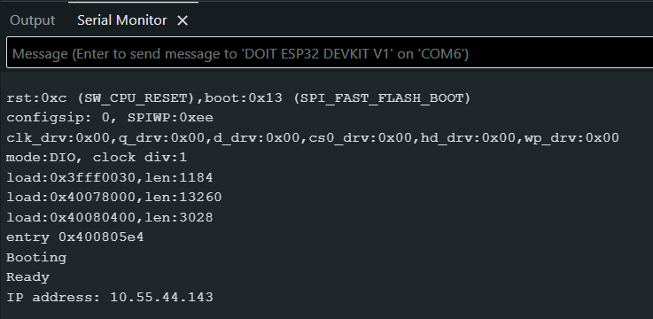
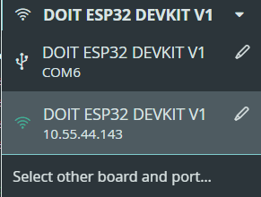
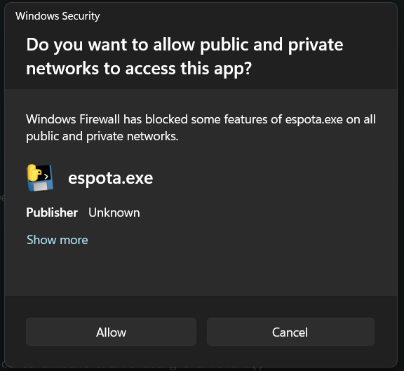
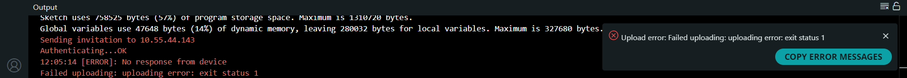
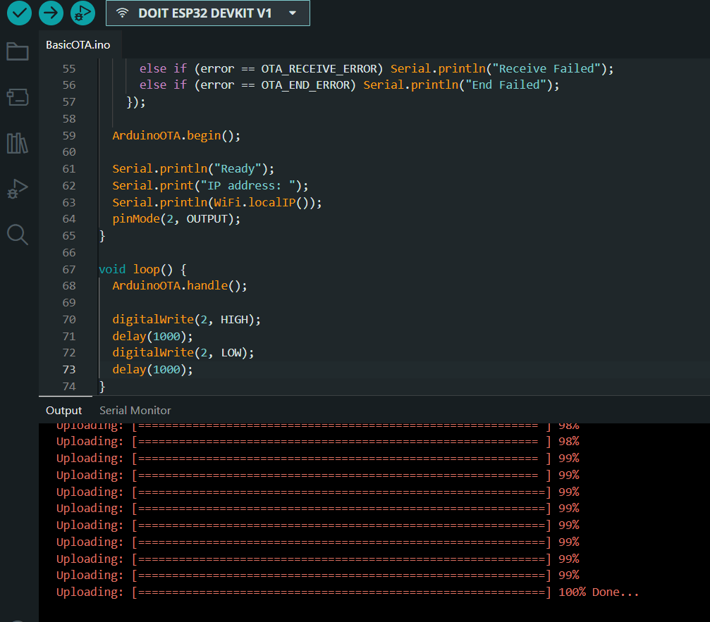
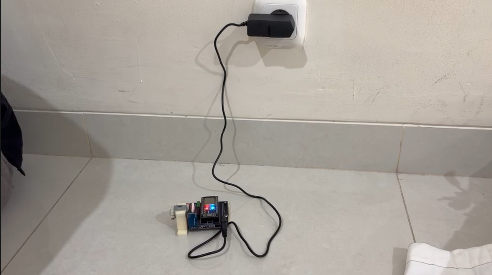
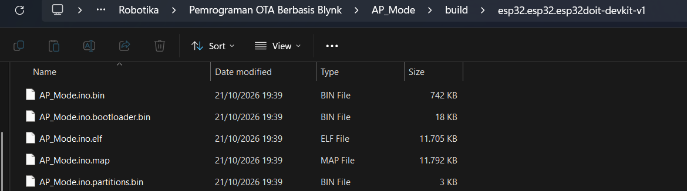
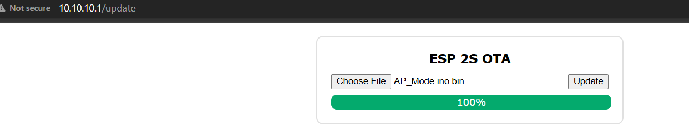

# Laporan Riset Modul 4 - Pemrograman OTA

Mata kuliah Robotika, ETS. Waktu praktik: Oktober 2026. Identitas penulis: lihat [README utama](../../README.md).

> **Catatan:** judul modul ini "OTA Berbasis Blynk". Pada riset ini yang diuji adalah dua metode OTA, yaitu ArduinoOTA dan OTA lewat web server (ESP2SOTA). Keduanya tidak memakai library Blynk, sehingga bagian OTA lewat Blynk Console tidak tercakup dalam laporan ini.

## 1. Pendahuluan

Setiap perubahan program pada ESP32 biasanya memerlukan kabel USB. Pada perangkat yang sudah terpasang di tempat sulit dijangkau, itu merepotkan. **OTA (Over The Air)** memungkinkan firmware baru dikirim lewat jaringan nirkabel. Modul ini mencoba dua metode: **ArduinoOTA** (upload dari Arduino IDE lewat WiFi) dan **OTA web server** (upload berkas `.bin` lewat halaman web milik ESP32).

## 2. Tujuan

1. Memahami prinsip dan syarat OTA pada ESP32.
2. Mengunggah program baru ke ESP32 lewat WiFi tanpa kabel USB dengan ArduinoOTA.
3. Mengunggah program lewat web server memakai berkas `.bin` pada mode Access Point.
4. Membandingkan kedua metode.

## 3. Alat dan bahan

| Komponen | Keterangan |
|---|---|
| ESP32 | DOIT ESP32 DEVKIT V1 |
| Laptop | Arduino IDE 2.3.10, browser |
| WiFi / hotspot | untuk ArduinoOTA (laptop dan ESP32 di jaringan yang sama) |
| Kabel USB | hanya untuk upload pertama |
| Library | `ArduinoOTA`, `ESPmDNS`, `WiFiUdp` (bawaan ESP32 core); `ESP2SOTA` (Library Manager) |

## 4. Landasan teori

### 4.1 Prinsip OTA

OTA bekerja karena flash ESP32 dibagi menjadi beberapa partisi: satu atau lebih untuk aplikasi (program) dan satu untuk data. Program yang sedang berjalan menerima berkas firmware baru lewat jaringan dan menuliskannya ke partisi aplikasi, lalu ESP32 restart dan menjalankan program baru.

Dua syarat penting:

1. **Upload pertama harus lewat USB**, karena belum ada program yang dapat menerima OTA.
2. **Program yang berjalan harus memuat kode OTA.** Jika program baru tidak memuat kode OTA, ESP32 tidak dapat diperbarui lewat WiFi lagi dan harus kembali ke kabel USB.

Program tersimpan di flash yang tidak hilang saat daya dicabut, sehingga program (dan kedipan LED-nya) tetap berjalan setelah kabel dilepas.

### 4.2 Kedua metode

| | ArduinoOTA | Web server OTA (ESP2SOTA) |
|---|---|---|
| Cara upload | langsung dari Arduino IDE (menu Port jaringan) | unggah berkas `.bin` lewat browser di halaman `/update` |
| Jaringan | ESP32 dan laptop di WiFi yang sama | ESP32 membuat WiFi sendiri (Access Point) |
| Autentikasi | password OTA | password WiFi AP |
| Kebutuhan | Arduino IDE | browser dan berkas `.bin` |
| Internet | tidak perlu (cukup satu jaringan lokal) | tidak perlu |

## 5. Eksperimen 4.1 - ArduinoOTA

**Kode:** [`BasicOTA/BasicOTA.ino`](BasicOTA/BasicOTA.ino)

### 5.1 Cara kerja kode

- `setup()` mengatur WiFi ke mode station dan menyambungkan ke jaringan. Jika gagal, ESP32 menunggu 5 detik lalu restart.
- `ArduinoOTA.setPassword(OTA_PASS)` mengaktifkan password OTA (nilainya di `secrets.h`). Password ini berbeda dari password WiFi; Arduino IDE memintanya saat upload nirkabel.
- Callback `onStart`, `onEnd`, `onProgress`, dan `onError` mencetak status ke Serial Monitor.
- Setelah tersambung, Serial Monitor mencetak `Ready` dan alamat IP.
- `loop()` memanggil `ArduinoOTA.handle()` agar permintaan upload dilayani, dan mengedipkan LED pada GPIO 2 sebagai penanda program berjalan.

### 5.2 Skenario uji

| Tahap | Program | LED GPIO 2 |
|---|---|---|
| Upload pertama (USB) | `delay(250)` ON dan OFF | berkedip tiap 250 ms (periode 500 ms, 2 Hz) |
| Update lewat WiFi (OTA) | `delay(1000)` ON dan OFF | berkedip tiap 1000 ms (periode 2 detik, 0,5 Hz) |

Perubahan dari 250 ms ke 1000 ms membuat kedipan melambat empat kali, sehingga mudah dilihat sebagai bukti update berhasil.

### 5.3 Langkah

1. Upload `BasicOTA` lewat USB, buka Serial Monitor (115200), catat alamat IP.
2. Cabut USB dan nyalakan board dari sumber daya lain. LED harus tetap berkedip.
3. Di Arduino IDE, pilih port jaringan ESP32 pada **Tools - Port - Network ports**.
4. Ubah `delay(250)` menjadi `delay(1000)`, lalu klik Upload.
5. Masukkan password OTA (`OTA_PASS` di `secrets.h`) saat diminta.
6. Amati Output Arduino IDE dan LED setelah ESP32 restart.

### 5.4 Hasil

Serial Monitor setelah tersambung:

```
Booting
Ready
IP address: 10.55.44.143
```

Ukuran program yang dilaporkan Arduino IDE:

```
Sketch uses 758525 bytes (57%) of program storage space. Maximum is 1310720 bytes.
Global variables use 47648 bytes (14%) of dynamic memory, leaving 280032 bytes
for local variables. Maximum is 327680 bytes.
```


*Gambar 4.1. Serial Monitor menampilkan "Ready" dan alamat IP.*


*Gambar 4.2. Port jaringan ESP32 di Arduino IDE (alamat IP tampil sebagai port).*


*Gambar 4.3. Kotak Windows Security untuk `espota.exe`.*


*Gambar 4.4. Upload gagal "No response from device" sebelum firewall diizinkan.*


*Gambar 4.5. Upload OTA berhasil (persentase upload sampai selesai).*

 
*Gambar 4.6-4.7. LED sebelum (250 ms) dan sesudah (1000 ms) update.*

### 5.5 Analisis

Urutan pesan saat upload pertama kali gagal sangat informatif:

```
Sending invitation to 10.55.44.143
Authenticating...OK
[ERROR]: No response from device
Failed uploading: uploading error: exit status 1
```

`Authenticating...OK` membuktikan laptop menemukan ESP32 dan password OTA diterima, jadi jaringan dan kode benar. Setelah autentikasi, arah koneksi berbalik: ESP32 membuka koneksi ke laptop untuk mengambil berkas firmware. Koneksi masuk ke laptop ini diblokir Windows Firewall untuk `espota.exe` (alat upload OTA bawaan Arduino), sehingga ESP32 tidak mendapat respons. Setelah `espota.exe` diizinkan pada jaringan Private dan Public, upload berhasil.

Kedipan LED yang berubah dari cepat ke lambat tanpa kabel USB adalah bukti langsung bahwa program baru sudah berjalan. LED yang tetap berkedip setelah kabel dicabut membuktikan program tersimpan di flash.

## 6. Eksperimen 4.2 - OTA web server (mode AP, ESP2SOTA)

**Kode:** [`AP_Mode/AP_Mode.ino`](AP_Mode/AP_Mode.ino), berkas hasil kompilasi: [`AP_Mode/firmware/AP_Mode.ino.bin`](AP_Mode/firmware/AP_Mode.ino.bin) (759.072 byte)

### 6.1 Cara kerja kode

- `WiFi.mode(WIFI_AP)` dan `WiFi.softAP(ssid, password)` menjadikan ESP32 pemancar WiFi sendiri (Access Point) dengan nama `AP_SSID` (pada riset ini `ESP2SOTA`) dan password `AP_PASS`, keduanya dari `secrets.h`.
- `WiFi.softAPConfig` menetapkan alamat IP ESP32 menjadi **`10.10.10.1`** dengan subnet `255.255.255.0`.
- `WebServer server(80)` membuat web server pada port 80. Rute contoh `/myurl` membalas teks `Hello there!`.
- `ESP2SOTA.begin(&server)` menambahkan halaman **`/update`** untuk mengunggah berkas `.bin`.
- `loop()` memanggil `server.handleClient()` supaya permintaan web dilayani, sambil mengedipkan LED GPIO 2 dengan periode 1 detik (ON 500 ms, OFF 500 ms).

Karena ESP32 membuat WiFi sendiri, metode ini tidak membutuhkan router atau hotspot, dan berguna di tempat tanpa jaringan.

### 6.2 Cara membuat berkas `.bin`

1. Buka sketch di Arduino IDE dan pilih board **DOIT ESP32 DEVKIT V1**.
2. Menu **Sketch - Export Compiled Binary** (Ctrl+Alt+S).
3. Menu **Sketch - Show Sketch Folder**, lalu buka `build/esp32.esp32.esp32doit-devkit-v1/`.
4. Pakai berkas **`AP_Mode.ino.bin`**. Berkas lain di folder itu tidak dipakai: `.bootloader.bin` dan `.partitions.bin` (bagian flash penuh lewat USB), `.elf` dan `.map` (untuk debug). Salin `AP_Mode.ino.bin` ke folder `AP_Mode/firmware/` agar tersimpan di repositori; folder `build/` sendiri tidak di-push.


*Gambar 4.8. Folder `build` berisi berkas `.bin`.*

### 6.3 Langkah upload

1. Upload `AP_Mode` ke ESP32 lewat USB (sekali).
2. Pada laptop, sambungkan WiFi ke **`ESP2SOTA`**, memakai password `AP_PASS` dari `secrets.h`.
3. Buka browser dan ketik **`10.10.10.1/update`**.
4. Pilih berkas `.bin` lalu unggah.
5. Tunggu sampai selesai. ESP32 restart dan menjalankan program baru.

Berkas yang diunggah adalah `AP_Mode.ino.bin` (hasil Export Compiled Binary dari sketch `AP_Mode`, 759.072 byte). Setelah proses unggah selesai, ESP32 restart dan menjalankan firmware tersebut.


*Gambar 4.9. Halaman `10.10.10.1/update` di browser.*


*Gambar 4.10. Upload `.bin` berhasil dan perilaku program berubah.*

### 6.4 Analisis

Halaman `/update` tampil karena `ESP2SOTA.begin(&server)` mendaftarkannya di web server ESP32. Sketch yang diunggah harus kembali memuat kode OTA (di sini ESP2SOTA); jika tidak, halaman `/update` akan hilang setelah update dan ESP32 hanya dapat diperbarui lewat USB. Karena laptop tersambung langsung ke WiFi milik ESP32, laptop tidak memiliki akses internet selama proses ini.

## 7. Perbandingan kedua metode

| Aspek | ArduinoOTA | Web server (ESP2SOTA, mode AP) |
|---|---|---|
| Kemudahan | upload langsung dari IDE, tinggal pilih port jaringan | perlu membuat `.bin` dan membuka browser |
| Jaringan | butuh WiFi/hotspot yang sama | tidak butuh jaringan lain (ESP32 jadi AP) |
| Kendala yang ditemui | firewall memblokir `espota.exe` | laptop terputus dari internet saat tersambung ke AP |
| Cocok untuk | pengembangan harian | pembaruan di lapangan tanpa Arduino IDE |
| Autentikasi | password OTA | password WiFi AP |

## 8. Kendala dan solusi

| Kendala | Penyebab | Solusi |
|---|---|---|
| LED tetap berkedip dan tidak dapat dimatikan setelah kabel dicabut | Program tersimpan di flash dan berjalan setiap board menyala | Upload program lain lewat USB atau OTA |
| Serial Monitor berulang menampilkan "Connection Failed! Rebooting..." dan LED tidak berkedip | WiFi tidak tersambung, sehingga `loop()` belum tercapai | Periksa hotspot (menyala, 2,4 GHz, nama dan password sama persis) |
| "No response from device" setelah "Authenticating...OK" | Windows Firewall memblokir `espota.exe` | Izinkan `espota.exe` pada jaringan Private dan Public, lalu upload ulang |
| "No monitor available for the port protocol network" | Port jaringan tidak memiliki Serial Monitor | Bukan error; gunakan USB untuk melihat Serial Monitor |

## 9. Kesimpulan

1. Pembaruan program ESP32 lewat WiFi berhasil dengan dua metode. ArduinoOTA mengubah kedipan LED dari 250 ms menjadi 1000 ms tanpa kabel USB, dan OTA web server menerima berkas `.bin` pada `10.10.10.1/update`.
2. OTA mensyaratkan upload pertama lewat USB dan program yang berjalan harus selalu memuat kode OTA.
3. Pada ArduinoOTA, autentikasi dan pengiriman memakai arah koneksi yang berbeda sehingga firewall dapat memblokir upload walaupun autentikasi berhasil.
4. Mode Access Point membuat OTA dapat dilakukan tanpa router, dengan konsekuensi laptop terputus dari internet selama proses.

## 10. Saran

Untuk memenuhi judul modul "OTA berbasis Blynk", pengembangan berikutnya dapat menambahkan Blynk pada sketch OTA (misalnya Blynk sebagai dashboard dan tombol pemicu mode update), atau memakai fitur OTA bawaan Blynk Console bila tersedia pada akun.

## Lampiran

Kode dan berkas modul ini (relatif terhadap folder modul):

- [`BasicOTA/BasicOTA.ino`](BasicOTA/BasicOTA.ino)
- [`BasicOTA/secrets.example.h`](BasicOTA/secrets.example.h)
- [`AP_Mode/AP_Mode.ino`](AP_Mode/AP_Mode.ino)
- [`AP_Mode/secrets.example.h`](AP_Mode/secrets.example.h)
- [`AP_Mode/firmware/AP_Mode.ino.bin`](AP_Mode/firmware/AP_Mode.ino.bin)

Kembali ke [ringkasan ETS](../README.md).


## Daftar pustaka

1. Rahmat, B. dan Muljono. *Pemrograman Internet of Things (IoT) dengan Arduino dan Python, Jilid 1*. CV Eureka Media Aksara.
2. Rahmat, B. *Integrasi AI dan IoT pada Sistem Kendali Cerdas* (materi kuliah), dan repositori kode kit iMCLab `github.com/bsrahmat/imclab`.
3. Dokumentasi Espressif untuk ESP32: pembaruan OTA dan WiFi Access Point.
4. Dokumentasi pustaka `ArduinoOTA` dan `ESP2SOTA`.